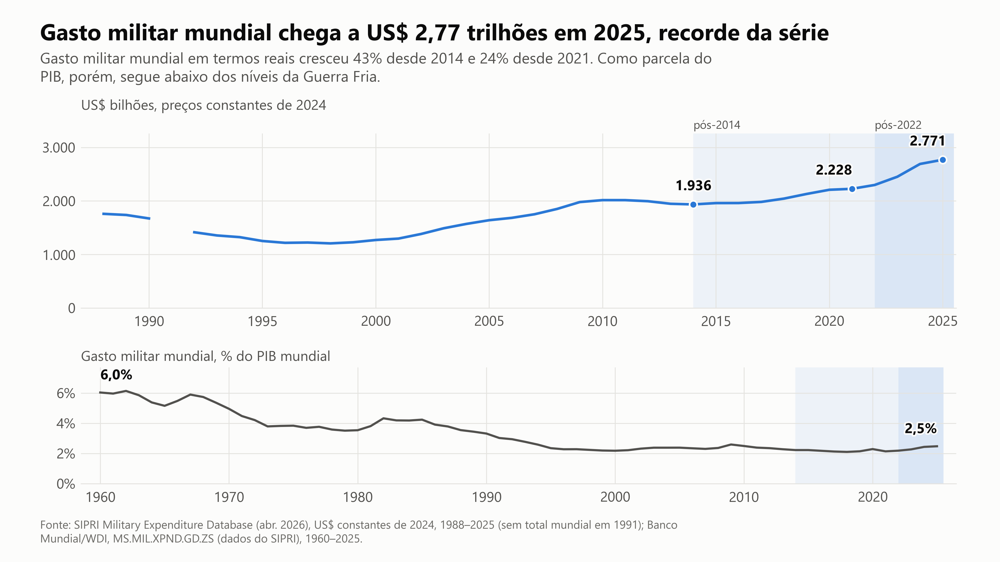
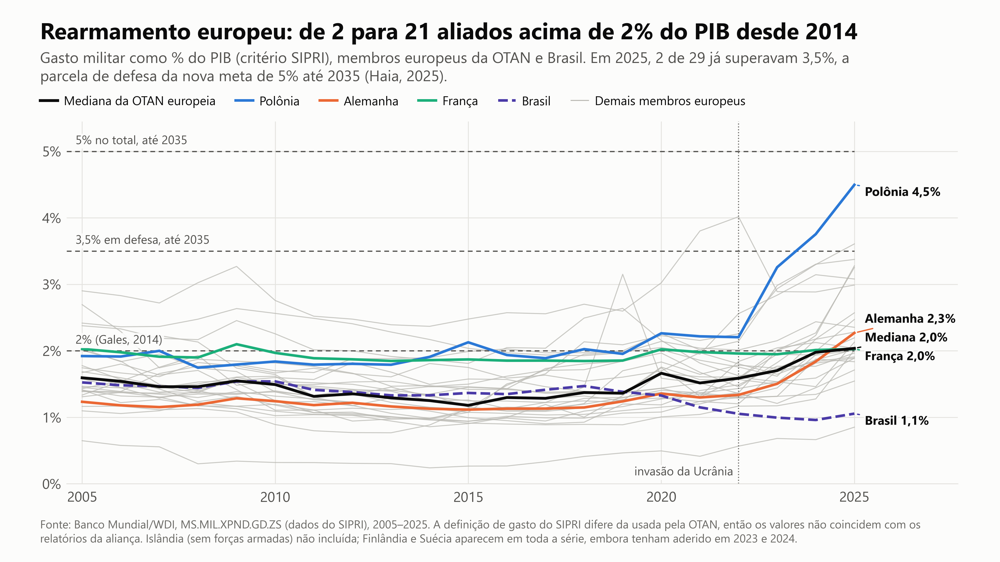
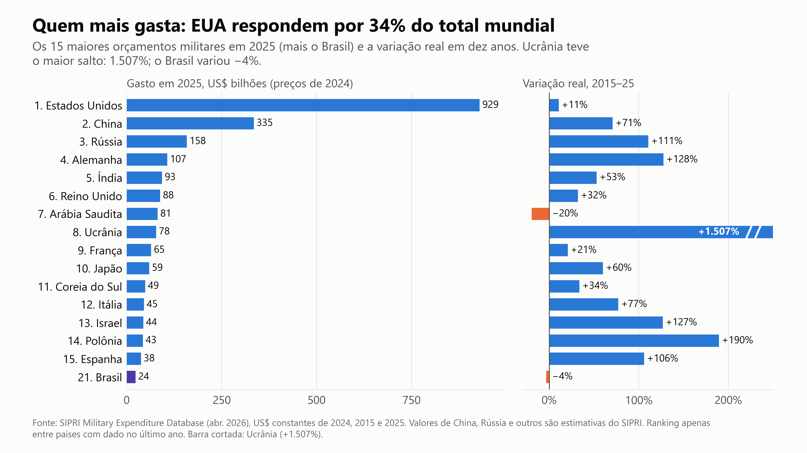
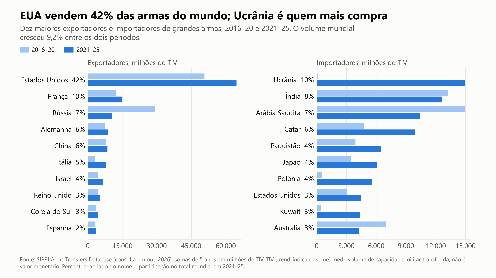
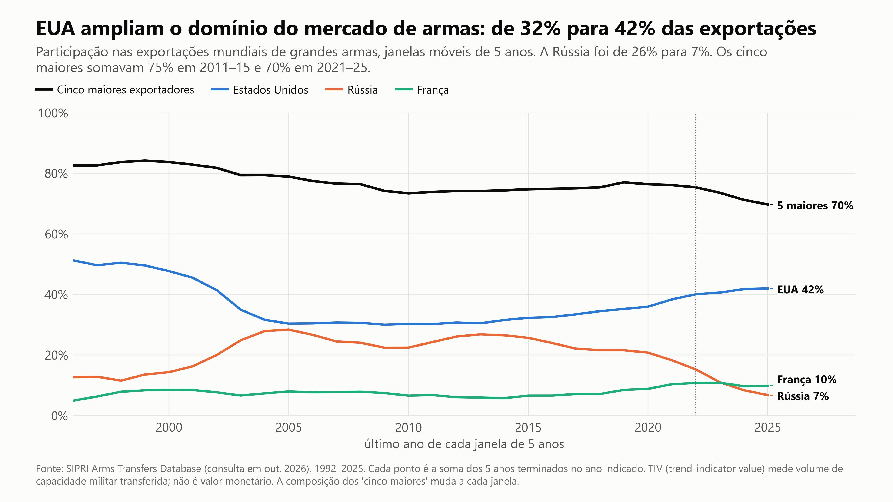
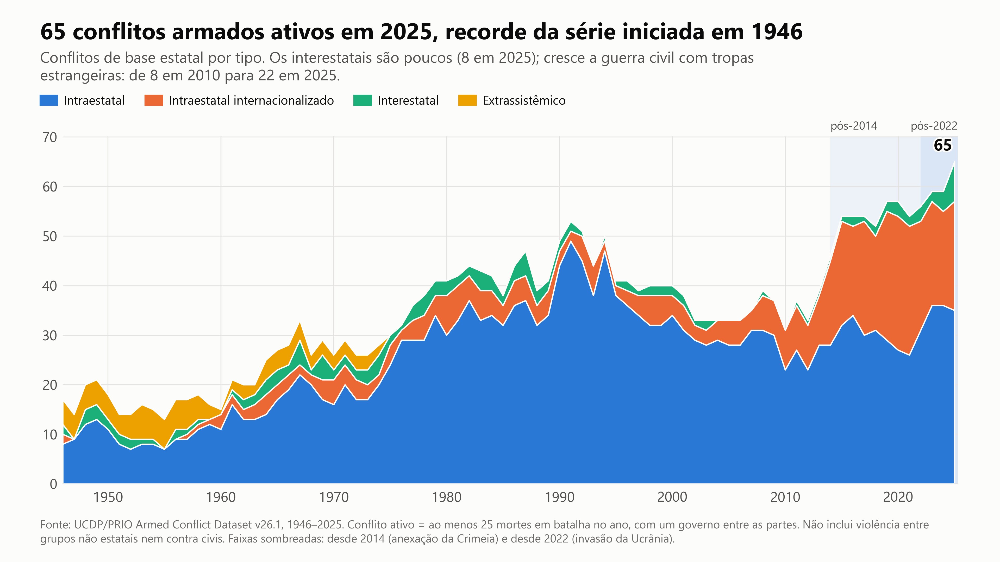
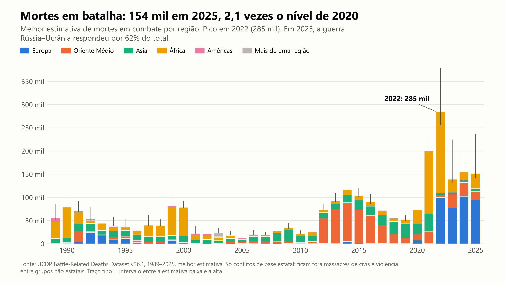
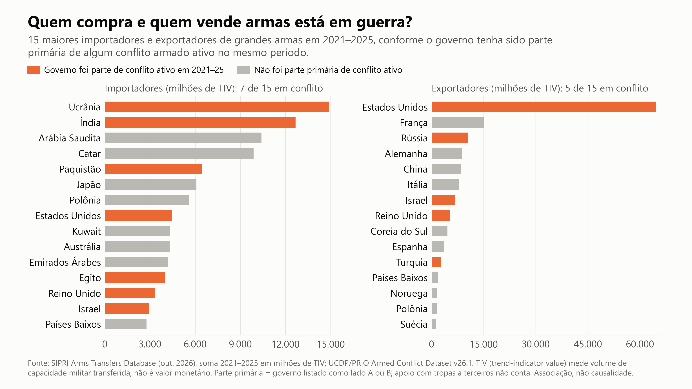
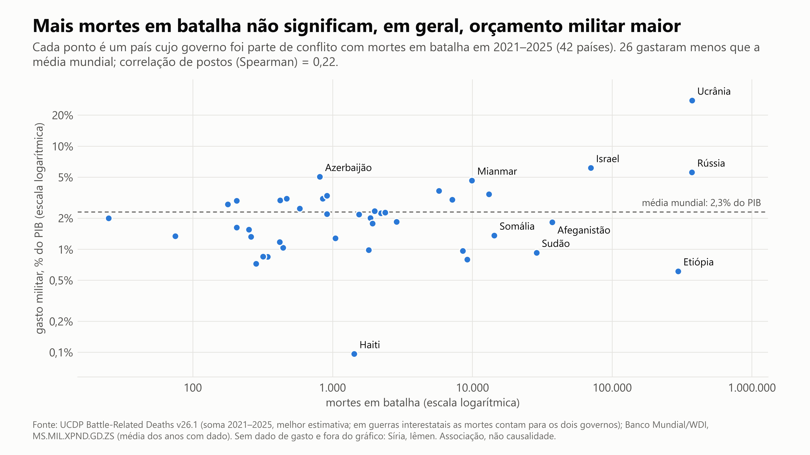
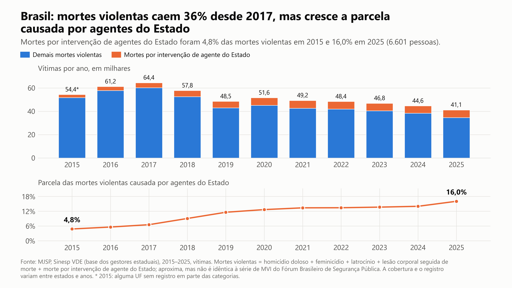

# Gasto militar, transferências de armas e conflitos armados (2014–2025)

**LADRI · ASCES** — grupo de pesquisa em análise de dados em Relações Internacionais
Versão 1.0, outubro de 2026 · dados até 2025, acessados em 13/10/2026

---

## Resumo

Este repositório reúne uma análise exploratória e reprodutível da relação entre gasto
militar, comércio internacional de armas e conflitos armados, com ênfase no período de
2014 a 2025. Os dados vêm de cinco bases públicas: SIPRI Military Expenditure Database,
SIPRI Arms Transfers Database, UCDP/PRIO Armed Conflict Dataset, UCDP Battle-Related
Deaths Dataset e Sinesp/MJSP. O processamento é integralmente automatizado em Python,
do download à geração das figuras.

Os resultados indicam que o gasto militar mundial atingiu US$ 2,77 trilhões em 2025
(preços constantes de 2024), o maior valor da série iniciada em 1988 e 43% acima do
nível de 2014. Como proporção do PIB mundial, contudo, o gasto (2,5%) permanece bem
abaixo do patamar da década de 1960 (6,0%). A expansão recente concentra-se na Europa,
onde o número de membros da OTAN acima de 2% do PIB passou de 2 para 21 entre 2014 e
2025. O mercado de armas tornou-se mais dependente dos Estados Unidos (42% das
exportações em 2021–25), enquanto a participação russa caiu de 26% para 7%. O UCDP
registra 65 conflitos de base estatal ativos em 2025, recorde desde 1946, oito deles
interestatais. No nível dos países, a associação entre intensidade do conflito e esforço
militar é fraca (ρ de Spearman = 0,22). Para o Brasil, a análise documenta a queda das
mortes violentas desde 2017 e o aumento da parcela atribuída a agentes do Estado, de
4,8% em 2015 para 16,0% em 2025.

**Palavras-chave:** gasto militar; comércio de armas; conflitos armados; OTAN; SIPRI;
UCDP; segurança internacional; violência letal no Brasil.

---

## 1. Questões de pesquisa

1. Como evoluiu o gasto militar mundial após 2014 e após 2022, em termos absolutos e
   relativos ao PIB?
2. Em que medida os membros europeus da OTAN convergiram para as metas da aliança, e
   como o Brasil se compara a eles?
3. Quem são os principais exportadores e importadores de armas, e quão concentrado é o
   mercado?
4. Como evoluíram o número de conflitos armados e as mortes em combate, por tipo e por
   região?
5. Há associação, no nível dos países, entre envolvimento em conflito, comércio de
   armas e gasto militar?
6. Como se comporta a violência letal no Brasil, em especial a causada por agentes do
   Estado?

## 2. Dados

| Base | Variáveis usadas | Cobertura | Versão |
|---|---|---|---|
| SIPRI Military Expenditure Database | Gasto militar em US$ constantes de 2024; totais regionais | 1949–2025 (total mundial desde 1988) | Edição de abril de 2026 |
| Banco Mundial, World Development Indicators | `MS.MIL.XPND.GD.ZS` (% do PIB) e `MS.MIL.XPND.CD` (US$ correntes), ambos com origem no SIPRI | 1960–2025 | Atualização de 08/10/2026 |
| SIPRI Arms Transfers Database | Volume de transferências de grandes armas, em TIV, por exportador e importador | 1992–2025 | Consulta de 13/10/2026 |
| UCDP/PRIO Armed Conflict Dataset | Conflitos ativos por ano, tipo e partes | 1946–2025 | v26.1 |
| UCDP Battle-Related Deaths Dataset | Mortes em batalha (estimativas baixa, melhor e alta) por conflito e região | 1989–2025 | v26.1 |
| MJSP, Sinesp VDE | Vítimas por tipo de ocorrência, por município e mês | 2015–2025 | Arquivos anuais publicados até out. 2026 |

URLs, datas de acesso e procedimentos de download manual estão em
[`data/README.md`](data/README.md). O arquivo `data/raw/_manifesto.json` registra, para
cada arquivo baixado, a URL exata, a data de acesso e a versão informada pela fonte.

## 3. Métodos

**Princípio geral.** Nenhum valor foi imputado, interpolado ou digitado manualmente.
Ausências na fonte permanecem como lacunas e são declaradas nas figuras (por exemplo, o
SIPRI não publica total mundial para 1991; Síria e Iêmen não têm dado de gasto em
2021–2025).

**Gasto militar.** Comparações no tempo usam US$ constantes de 2024 (SIPRI). A
proporção do PIB vem do Banco Mundial, que reproduz a série do SIPRI; as duas fontes
coincidem nos 150 países com dado em 2025. Os percentuais seguem a definição de gasto
militar do SIPRI, que difere da adotada pela OTAN, de modo que não reproduzem os números
oficiais da aliança. A Islândia, sem forças armadas, foi excluída do grupo europeu da
OTAN; Finlândia e Suécia integram a série inteira, apesar da adesão em 2023 e 2024.

**Metas da OTAN.** São marcadas a meta de 2% do PIB (Cúpula de Gales, 2014) e a meta
de 5% até 2035 (Cúpula de Haia, junho de 2025), composta de 3,5% para defesa
propriamente dita e 1,5% para gastos correlatos. A linha de 3,5% é a comparável ao
conceito de gasto militar.

**Transferências de armas.** O SIPRI mede volume em TIV (*trend-indicator value*), um
indicador de capacidade militar transferida baseado em custos de produção de
referência. **O TIV não é valor monetário**: não equivale a preço pago nem a receita de
exportação. Para reduzir a volatilidade das entregas, usam-se somas de cinco anos
(2016–20 e 2021–25) e, para a concentração do mercado, janelas móveis de cinco anos.

**Conflitos e mortes.** Adota-se a definição do UCDP: conflito de base estatal é
uma incompatibilidade em que ao menos uma das partes é um governo e que causa 25 ou
mais mortes em batalha no ano. Os tipos são extrassistêmico, interestatal, intraestatal
e intraestatal internacionalizado. As mortes usam a melhor estimativa, com o intervalo
entre as estimativas baixa e alta exibido nas figuras.

**Envolvimento por país.** Um país é considerado envolvido em conflito quando seu
governo aparece como parte primária (lado A ou B) no UCDP. Apoio com tropas a outro
governo não conta. Em guerras interestatais, as mortes são atribuídas integralmente a
cada governo participante; por isso, somas entre países contam essas mortes em dobro.
A associação entre mortes em batalha e gasto militar (% do PIB) é medida pela
correlação de postos de Spearman, adequada a distribuições muito assimétricas.

**Brasil.** As mortes violentas somam cinco categorias do Sinesp: homicídio doloso,
feminicídio, latrocínio, lesão corporal seguida de morte e morte por intervenção de
agente do Estado. A soma aproxima, mas não reproduz, o indicador de mortes violentas
intencionais (MVI) do Fórum Brasileiro de Segurança Pública. O Sinesp foi preferido por
permitir download automático e auditável. O ano de 2026, ainda incompleto, foi excluído.

**Controle de qualidade.** Os números citados neste documento são impressos
diretamente das tabelas processadas por `src/verifica.py`, que também confronta o
Banco Mundial com a planilha do SIPRI. As figuras passam por uma auditoria automática
de layout (`src/auditoria.py`) que reprova texto cortado, sobreposto ou abaixo do
tamanho mínimo.

## 4. Resultados

### 4.1 Gasto militar mundial



O gasto militar mundial chegou a US$ 2.771 bilhões em 2025, alta real de 43,1% sobre
2014 e de 24,4% sobre 2021. O peso do gasto no PIB mundial subiu de 2,2% (2014) para
2,5% (2025), mas segue muito abaixo dos 6,0% de 1960. A Europa respondeu pela maior
parte da expansão recente: de US$ 452 bilhões em 2021 para US$ 791 bilhões em 2025
(+75%).

### 4.2 Membros europeus da OTAN e Brasil



Entre os 29 membros europeus da OTAN com dado, os que gastavam 2% do PIB ou mais
passaram de 2 em 2014 para 5 em 2021 e 21 em 2025; a mediana subiu de 1,25% para 2,04%.
Pela régua de 3,5% fixada em Haia, apenas Polônia (4,50%) e Letônia (3,61%) estavam
acima do patamar em 2025. O Brasil seguiu trajetória oposta: 1,33% do PIB em 2014 e
1,05% em 2025.

### 4.3 Maiores orçamentos militares



Os Estados Unidos gastaram US$ 929 bilhões em 2025, 33,5% do total mundial; os cinco
maiores (EUA, China, Rússia, Alemanha e Índia) somam 58,5%. Entre 2015 e 2025, o gasto
real da Ucrânia cresceu 1.507%, o da Polônia 190%, e os de Alemanha (128%), Israel
(127%) e Rússia (111%) mais que dobraram. A Arábia Saudita recuou 20%. O Brasil ocupa
a 21ª posição, com US$ 23,6 bilhões e variação real de −3,5%.

### 4.4 Exportadores e importadores de armas



O volume mundial de transferências cresceu 9,2% entre 2016–20 e 2021–25. Os Estados
Unidos responderam por 41,9% das exportações no segundo período, seguidos de França
(9,8%) e Rússia (6,8%); as exportações russas caíram 64,5% e as italianas cresceram
157%. Entre os importadores, a Ucrânia passou ao primeiro lugar (9,7%), à frente de
Índia (8,2%), Arábia Saudita (6,7%) e Catar (6,4%). O Brasil é o 25º importador (1,2%).

### 4.5 Concentração do mercado



A participação dos Estados Unidos nas exportações passou de 32% (2011–15) para 42%
(2021–25), e a da Rússia caiu de 26% para 7%. A fatia somada dos cinco maiores
exportadores recuou de 75% para 70%, com o avanço de fornecedores intermediários como
Itália, Israel e Coreia do Sul. O mercado, portanto, tornou-se mais dependente do líder
e ligeiramente menos concentrado no topo.

### 4.6 Conflitos armados



O UCDP registra 65 conflitos de base estatal ativos em 2025, o maior número desde 1946
(eram 31 em 2010 e 54 em 2021): 35 intraestatais, 22 intraestatais internacionalizados
e 8 interestatais. O número de conflitos interestatais é o maior da série; o máximo
anterior era 5. Entre eles estão Rússia–Ucrânia, Índia–Paquistão, Irã–Israel,
Camboja–Tailândia e Afeganistão–Paquistão.

### 4.7 Mortes em batalha



Foram 153.643 mortes em batalha em 2025 (intervalo de 141.388 a 237.196), 2,1 vezes o
total de 2020. O pico da série recente é 2022 (284.981), ano em que a guerra na Etiópia
(163.219) superou a guerra Rússia–Ucrânia (99.473). Em 2025, Rússia–Ucrânia concentrou
62% das mortes (94.741), seguida de Israel/Palestina, Sudão, RD Congo e Etiópia.

### 4.8 Envolvimento em conflito e comércio de armas



Dos 15 maiores importadores de 2021–25, sete tiveram o governo como parte primária de
conflito ativo no período (Ucrânia, Índia, Paquistão, Estados Unidos, Egito, Reino
Unido e Israel). Entre os 15 maiores exportadores, cinco (Estados Unidos, Rússia,
Israel, Reino Unido e Turquia). Grandes importadores como Arábia Saudita, Catar, Japão
e Polônia não figuram como partes primárias de conflito ativo.

### 4.9 Gasto militar e intensidade do conflito



Entre os 42 países cujo governo foi parte de conflito com mortes em 2021–25 e que têm
dado de gasto, a correlação de Spearman entre mortes em batalha e gasto militar (% do
PIB) é 0,22, e 26 deles gastaram menos que a média mundial (2,3% do PIB). Os extremos
ilustram a heterogeneidade: a Ucrânia destinou em média 27,7% do PIB à defesa, enquanto
a Etiópia, com cerca de 297 mil mortes no período, declarou 0,6%.

### 4.10 Violência letal no Brasil



As mortes violentas registradas no Sinesp caíram de 64.435 em 2017 para 41.144 em 2025
(−36%). As mortes por intervenção de agentes do Estado seguiram direção oposta, de
2.616 em 2015 para 6.601 em 2025, e mantêm-se estáveis entre 6,2 mil e 6,6 mil por ano
desde 2020. Com a queda do total, sua participação subiu de 4,8% para 16,0%.

## 5. Discussão

Os dados sugerem três padrões. Primeiro, a escalada recente do gasto militar é real em
termos absolutos, mas moderada quando relativizada pelo tamanho da economia mundial; o
que mudou de forma mais nítida foi a distribuição geográfica do esforço, deslocado para
a Europa. Segundo, o mercado internacional de armas passa por uma recomposição em favor
dos Estados Unidos e de fornecedores ocidentais intermediários, em detrimento da
Rússia. Terceiro, o aumento do número de conflitos e o retorno da guerra interestatal
não se traduzem, no nível dos países, numa relação simples entre conflito e gasto
militar: a associação é fraca e depende fortemente de casos extremos e de países com
dados ausentes.

## 6. Limitações

- **Comparabilidade do gasto.** Valores de China, Rússia e outros países pouco
  transparentes são estimativas do SIPRI. Gasto fora do orçamento, financiamento
  externo e forças paramilitares não são captados de forma homogênea.
- **Natureza do TIV.** O indicador não mede valor financeiro e exclui armas leves,
  munição e boa parte dos sistemas de baixo custo, como drones comerciais.
- **Escopo do UCDP.** As séries usadas cobrem apenas violência de base estatal. Ficam
  de fora a violência entre grupos não estatais e a violência deliberada contra civis,
  relevantes em contextos como Sudão, Sahel e Gaza. As estimativas de mortes têm
  incerteza ampla.
- **Viés de seleção na Figura 9.** Países em guerras graves frequentemente não
  divulgam dados de gasto (Síria, Iêmen) ou o fazem de forma intermitente (Sudão e
  Afeganistão têm um único ano no período).
- **Registros administrativos no Brasil.** A cobertura do Sinesp varia entre unidades
  da federação e ao longo do tempo; em 2015, uma UF não tem registro em parte das
  categorias. Parte do aumento das mortes por intervenção de agentes do Estado pode
  refletir melhora do registro.
- **Inferência.** As análises são descritivas. As associações apresentadas não
  autorizam conclusões causais.

## 7. Reprodutibilidade

Requer Python 3.11 ou superior (testado em Python 3.14, Windows 11).

```bash
python -m venv .venv
.venv\Scripts\activate          # Linux/macOS: source .venv/bin/activate
pip install -r requirements.txt
python -m src.pipeline
```

O pipeline baixa os dados, gera as tabelas processadas, produz as figuras e imprime os
números citados neste documento. A primeira execução transfere cerca de 280 MB e leva
de 20 a 30 minutos, sobretudo pelos arquivos do Sinesp. As execuções seguintes usam os
arquivos em cache. Os dados brutos não são versionados; as tabelas processadas estão em
`data/processed/` e permitem regerar as figuras sem novo download.

| Comando | Função |
|---|---|
| `python -m src.download` | Baixa as bases e atualiza o manifesto |
| `python -m src.limpeza` | Gera as tabelas de `data/processed/` |
| `python -m src.graficos [n ...]` | Gera todas as figuras ou apenas as indicadas |
| `python -m src.auditoria` | Regera as figuras e audita o layout (código de saída 1 em caso de falha) |
| `python -m src.verifica` | Imprime os números usados no texto e o cruzamento entre fontes |

O notebook [`notebooks/analise.ipynb`](notebooks/analise.ipynb) percorre a análise do
início ao fim. Além das figuras 16:9 versionadas aqui, o código gera localmente versões
em SVG e no formato 4:5 (1080×1350 px) para divulgação.

## 8. Estrutura do repositório

```
├── README.md                 este documento
├── requirements.txt          dependências
├── data/
│   ├── README.md             fontes, versões, download manual e cuidados de leitura
│   ├── raw/_manifesto.json   URL, data de acesso e versão de cada arquivo baixado
│   └── processed/            nove tabelas limpas (CSV) usadas nas figuras
├── notebooks/
│   └── analise.ipynb         análise completa, executada
├── outputs/figures/          dez figuras em PNG, 3840×2160 px
└── src/
    ├── config.py             caminhos, listas de países e metas da OTAN
    ├── download.py           aquisição dos dados
    ├── limpeza.py            padronização e agregação
    ├── graficos.py           uma função por figura
    ├── auditoria.py          controle de qualidade do layout das figuras
    ├── verifica.py           conferência dos números citados
    └── pipeline.py           execução de ponta a ponta
```

## 9. Como citar

> LADRI – ASCES. *Gasto militar, transferências de armas e conflitos armados
> (2014–2025)*. Versão 1.0. Repositório de dados e código, out. 2026. Disponível em:
> https://github.com/ladriasces/Conflitos---Gastos-Militares-.

Ao usar os dados, cite também as fontes originais listadas abaixo.

## 10. Referências

GLEDITSCH, N. P. et al. Armed Conflict 1946–2001: A New Dataset. *Journal of Peace
Research*, v. 39, n. 5, p. 615–637, 2002.

MINISTÉRIO DA JUSTIÇA E SEGURANÇA PÚBLICA. *Sinesp VDE: base de dados e notas
metodológicas dos gestores estaduais, 2015–2025*. Brasília: MJSP, 2026.

NORTH ATLANTIC TREATY ORGANIZATION. *The Hague Summit Declaration*. Haia, 25 jun. 2025.

STOCKHOLM INTERNATIONAL PEACE RESEARCH INSTITUTE. *SIPRI Military Expenditure Database*.
Estocolmo: SIPRI, 2026. Disponível em: https://www.sipri.org/databases/milex.

STOCKHOLM INTERNATIONAL PEACE RESEARCH INSTITUTE. *SIPRI Arms Transfers Database*.
Estocolmo: SIPRI, 2026. Disponível em: https://www.sipri.org/databases/armstransfers.

UPPSALA CONFLICT DATA PROGRAM. *UCDP/PRIO Armed Conflict Dataset*, versão 26.1, e
*UCDP Battle-Related Deaths Dataset*, versão 26.1. Uppsala: Universidade de Uppsala,
2026. Disponível em: https://ucdp.uu.se/downloads/.

WORLD BANK. *World Development Indicators*: MS.MIL.XPND.GD.ZS e MS.MIL.XPND.CD.
Washington, DC: World Bank, 2026. Disponível em: https://data.worldbank.org.

> Os livros de códigos do UCDP indicam o artigo anual a ser citado para cada versão;
> recomenda-se conferi-lo em https://ucdp.uu.se/downloads/ antes de publicar.

## Nota sobre o desenvolvimento

O código e a primeira versão dos textos foram produzidos com assistência do Claude
(Anthropic), sob orientação e revisão do LADRI. Todos os números foram gerados a partir
das bases citadas e conferidos com `src/verifica.py`.
